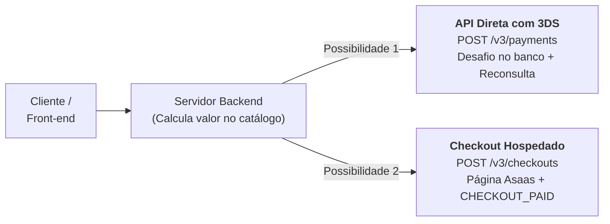
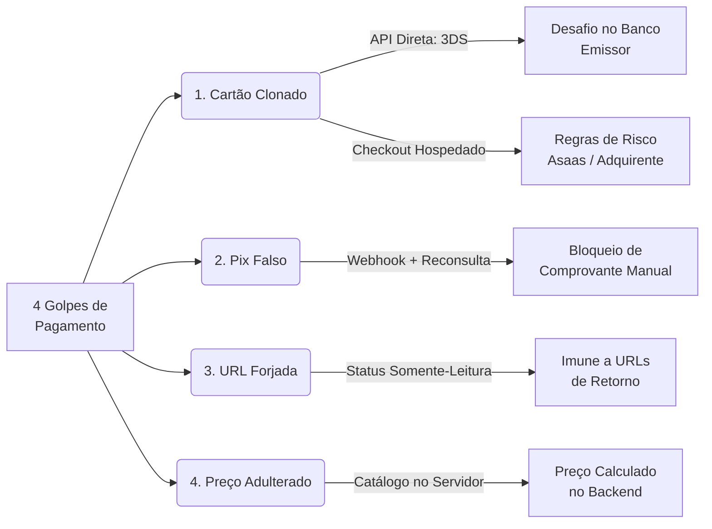
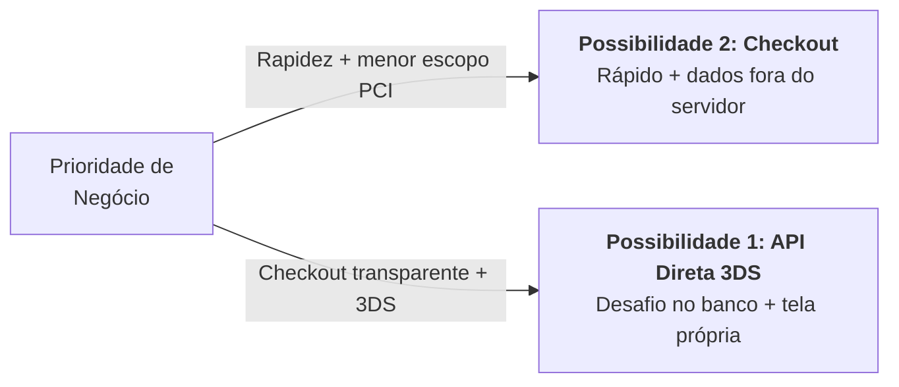
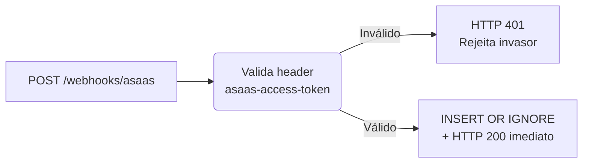
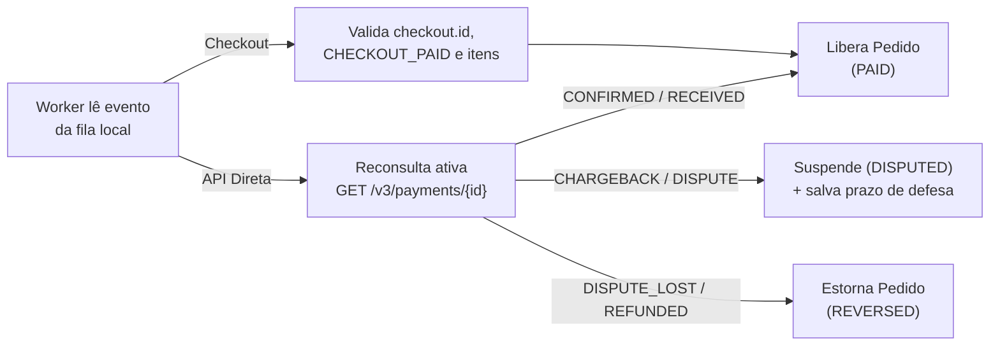

# Proposta de Arquitetura e Integração Antifraude Asaas

## Solução Técnica para Neutralização de Fraudes: API Direta com 3DS vs. Checkout Hospedado

---

## 1. Sumário Executivo

A empresa solicitou a integração com o gateway **Asaas** com o objetivo central de:

> _"Tornar o processo de pagamento seguro e confiável, reduzindo os riscos de fraude e garantindo que as informações de pagamento sejam verdadeiras."_

Foi repassada à equipe a recomendação de implementar o **"Sistema 3DS"**. A pesquisa minuciosa na documentação oficial do Asaas ([docs.asaas.com](https://docs.asaas.com/docs/portugu%C3%AAs/llms.txt)) revelou que:

1. **O 3DS não é um produto isolado:** Trata-se do protocolo _3-D Secure_ disponível especificamente na **API Direta de Cobrança** (`POST /v3/payments`), exigindo o envio dos objetos `threeDSecure` e `deviceInfo`.
2. **Existem Duas Vias de Arquitetura Oficiais:**
   - **Possibilidade 1: API Direta com Sistema 3DS:** Mantém o cliente no domínio da empresa (checkout transparente) e autentica o portador junto ao banco emissor (`DATA_ONLY`, `FRICTIONLESS` ou `ISSUER_CHALLENGE`) antes da captura da cobrança. Exige habilitação do 3DS pelo suporte do Asaas em produção.
   - **Possibilidade 2: Asaas Checkout Hospedado (`POST /v3/checkouts`):** Redireciona o comprador para uma página hospedada pelo próprio Asaas, com suporte a Pix e Cartão, reduzindo o escopo de [PCI-DSS](https://docs.asaas.com/docs/pci-dss-1) da empresa (o Asaas não define o SAQ aplicável; isso cabe a adquirente/QSA).
3. **Mitigação dos demais 3 golpes em ambas as vias:** Seja qual for a escolha adotada pela diretoria, os golpes de **comprovante falso de Pix**, **confirmação forjada por URL de retorno** e **adulteração de preços no front-end** são tratados por princípios de design seguro de backend (confirmação só por Webhook autenticado + reconsulta, status somente-leitura e preço sempre calculado no servidor).

---

## 2. Diagnóstico: Anatomia dos 4 Golpes Atuais

A vulnerabilidade atual decorre de falhas estruturais de validação entre cliente e servidor:

| #     | Golpe                                    | Causa Raiz                   | Como o Fraudador Age                                                      | Impacto Financeiro                                                    |
| ----- | ---------------------------------------- | ---------------------------- | ------------------------------------------------------------------------- | --------------------------------------------------------------------- |
| **1** | **Cartão clonado / roubado**             | Sem validação do titular     | Usa dados de cartão vazados; aprova porque a numeração é válida.          | O titular real contesta (_chargeback_); perde-se o produto e o valor. |
| **2** | **Comprovante falso de Pix**             | Confiança em print/PDF       | Adultera comprovante bancário e envia ao atendimento ou sistema.          | Produto/serviço liberado sem entrada real do dinheiro na conta.       |
| **3** | **Confirmação forjada (URL de retorno)** | Confiança no navegador       | Acessa diretamente `/pedido/sucesso` ou manipula o redirecionamento.      | O sistema marca o pedido como "Pago" sem existir transação real.      |
| **4** | **Adulteração de valores**               | Preço enviado pelo front-end | Intercepta a requisição e reduz o preço (ex.: `R$ 199,90` para `R$ 0,01`). | Venda aprovada por valor irrisório.                                   |

---

## 3. Visão Geral das Duas Possibilidades de Arquitetura



---

## 4. Comparativo Detalhado: API Direta (3DS) vs. Checkout Hospedado

| Critério                        | Possibilidade 1: API Direta com 3DS                                                                                                                                     | Possibilidade 2: Asaas Checkout Hospedado                                                                                             |
| ------------------------------- | ----------------------------------------------------------------------------------------------------------------------------------------------------------------------- | ------------------------------------------------------------------------------------------------------------------------------------- |
| **Endpoint Principal**          | [`POST /v3/payments`](https://docs.asaas.com/reference/criar-cobranca-com-cartao-de-credito)                                                                            | [`POST /v3/checkouts`](https://docs.asaas.com/reference/criar-novo-checkout)                                                          |
| **Experiência do Usuário (UX)** | **Checkout transparente:** o formulário de cartão fica no site da loja. Se houver desafio 3DS, o pagador é redirecionado ao banco emissor e volta para a `callbackUrl`. | **Página hospedada:** o `id` retornado na criação é usado para montar a URL `https://asaas.com/checkoutSession/show?id=<id>`.         |
| **Prevenção de Cartão Clonado** | **3DS:** o banco emissor avalia o dispositivo e, se necessário, exige desafio (OTP / app do banco) antes da captura.                                                    | **Não documentado:** o guia de Checkout consultado não menciona 3DS; confirmar com o Asaas.                                           |
| **Responsabilidade Financeira** | **Sem garantia documentada:** a doc do Asaas não afirma transferência de responsabilidade; chargebacks continuam possíveis e devem ser defendidos (`/dispute`).         | O estabelecimento segue as regras contratuais padrão de contestação.                                                                  |
| **Conformidade com PCI-DSS**    | **Maior escopo:** números de cartão trafegam pelos seus servidores. O SAQ aplicável deve ser definido com adquirente/QSA (o Asaas não o define).                        | **Menor escopo:** os dados de cartão não passam pela sua infraestrutura. O SAQ também deve ser validado.                              |
| **Pix Integrado**               | Requer chamada específica a [`GET /v3/payments/{id}/pixQrCode`](https://docs.asaas.com/reference/obter-qr-code-para-pagamentos-via-pix) para renderizar na tela.        | Nativo: a página de checkout já exibe Cartão e Pix dinâmico simultaneamente.                                                          |
| **Confirmação Financeira**      | Eventos `PAYMENT_CONFIRMED` / `PAYMENT_RECEIVED` + Reconsulta ativa com `GET /v3/payments/{id}`.                                                                        | Evento `CHECKOUT_PAID` com conferência do `checkout.id` guardado na criação, status e soma dos itens.                                 |
| **Tempo de Implementação**      | **Médio a Alto:** Requer telemetria de dispositivo (`deviceInfo`), tratamento do desafio e habilitação do 3DS pelo suporte do Asaas.                                    | **Rápido:** Poucas chamadas de API, página de checkout pronta e responsiva.                                                           |

---

## 5. Como Cada Possibilidade Neutraliza os 4 Golpes



### Detalhamento das Proteções:

### 1. Cartão Clonado / Roubado

- **Na Possibilidade 1 (API Direta + 3DS):** Quando o sistema envia `threeDSecure` e `deviceInfo`, o banco emissor decide o tipo de autenticação: `DATA_ONLY` (silenciosa, avaliada pelos dados do dispositivo), `FRICTIONLESS` (aprovação automática) ou `ISSUER_CHALLENGE` (o portador precisa se autenticar, por exemplo com OTP ou no app do banco). Quando há desafio, a resposta traz `threeDSecureChallengeUrl` e o pagador é redirecionado a ela; um fraudador sem acesso ao celular/app do titular não conclui o desafio e o Asaas envia `PAYMENT_CREDIT_CARD_THREE_D_SECURE_CHALLENGE_FAILED`, sem captura da cobrança.
- **Na Possibilidade 2 (Checkout Hospedado):** o pagamento ocorre na página do Asaas. A documentação consultada não descreve 3DS nem antifraude específico nessa via; a proteção contra cartão clonado aqui depende das regras de risco da conta e da adquirente, e deve ser confirmada com o Asaas.

> [!IMPORTANT]
> **Limites do 3DS:** A documentação do Asaas não afirma que o 3DS transfira a responsabilidade por chargeback. Trate-o como uma camada adicional de autenticação, não como garantia de isenção. Contestações continuam possíveis (inclusive `COMMERCIAL_DISAGREEMENT`, por exemplo). Por isso a arquitetura, ao receber um chargeback, suspende o pedido e consulta `GET /v3/payments/{id}/chargeback` para registrar o motivo e o prazo `deadlineToSendDisputeDocuments`, permitindo a defesa via `POST /v3/chargebacks/{id}/dispute`. Se o chargeback for revertido a favor da loja (`REVERSED`), o pedido volta a `PAID`; se a disputa for perdida (`DISPUTE_LOST`), vai para `REVERSED`.

### 2. Comprovante Falso de Pix

- **Ambas as soluções:** Nenhum ser humano e nenhuma rotina aceita comprovantes em anexo.
- O Pix é gerado de forma dinâmica e vinculado ao ID do pedido. A liberação de acesso ou produto ocorre **estritamente quando o Asaas notifica o recebimento** via Webhook autenticado.

### 3. Confirmação Forjada (URL de Retorno)

- **Ambas as soluções:** URLs de sucesso (`/pedido/{id}/processando`) são páginas meramente informativas e **somente-leitura**. A própria documentação do Asaas orienta a não usar as URLs de `callback` para confirmar pagamento. A página apenas consulta o banco local via `GET /api/orders/{id}/status`.
- O status do pedido só muda para `PAID` no servidor, disparado pela confirmação do Asaas. Se um golpista digitar `/pedido/sucesso`, o sistema consultará o backend e mostrará "Pagamento Pendente".

### 4. Adulteração de Valores

- **Ambas as soluções:** O cliente envia apenas os identificadores dos produtos (`sku`) e quantidades.
- O valor unitário é recuperado exclusivamente de um catálogo centralizado no backend. Na API Direta, o worker confere `remote_payment.value == order.total`; no Checkout Hospedado, o valor é fixado na criação da sessão e o worker confere, em `CHECKOUT_PAID`, que a soma dos itens (`value × quantity`) é igual ao total do pedido. Qualquer divergência de centavos retém o pedido por segurança.

---

## 6. Matriz de Decisão: Quando Escolher Cada Abordagem?



### Escolha a **Possibilidade 1 (API Direta com 3DS)** se:

1. O índice de perdas financeiras por cartões clonados for crítico e exigir autenticação formal no app bancário;
2. A identidade visual da marca exigir que o formulário de pagamento permaneça no domínio da empresa (o desafio 3DS, quando ocorre, redireciona ao banco emissor);
3. A equipe tiver capacidade para atender ao [PCI-DSS](https://docs.asaas.com/docs/pci-dss-1) (CVV nunca armazenado, sem dados completos de cartão em logs). O enquadramento (SAQ) deve ser definido com adquirente, bandeira ou um QSA — o Asaas não o define;
4. Houver tempo para solicitar a habilitação do 3DS à equipe de suporte do Asaas (exigido para produção).

### Escolha a **Possibilidade 2 (Checkout Hospedado)** se:

1. O objetivo for colocar a solução no ar com máxima rapidez;
2. A empresa desejar **reduzir o escopo de PCI-DSS**, pois o formulário de cartão fica na página do Asaas e os dados não passam pelos seus servidores (a validação formal continua cabendo a adquirente/QSA);
3. A experiência de redirecionamento para o checkout oficial do Asaas for bem aceita pelo modelo de negócio;
4. A prioridade imediata for neutralizar Pix falso, URL forjada e preço adulterado.

---

## 7. Arquitetura do Mecanismo de Webhook Blindado

O Webhook é o coração financeiro de ambas as integrações. Para garantir alta disponibilidade e evitar problemas documentados pelo Asaas, o processamento é dividido em duas fases:

**Fase 1 — Recepção Síncrona (milissegundos):**



**Fase 2 — Processamento Assíncrono (Worker em background):**



### Por que essa divisão em duas fases é indispensável?

| Fase                                       | O que faz                                                                                                                                                                             | Por que é necessária?                                                                                                                                                               |
| ------------------------------------------ | ------------------------------------------------------------------------------------------------------------------------------------------------------------------------------------- | ----------------------------------------------------------------------------------------------------------------------------------------------------------------------------------- |
| **1. Recepção Síncrona** _(milissegundos)_ | Valida o token e salva o evento no banco local com `INSERT OR IGNORE`, retornando `HTTP 200` imediatamente.                                                                           | A documentação do Asaas alerta que **após 15 falhas consecutivas, a fila de webhooks da conta é pausada**. Não se deve processar regras de negócio pesadas dentro da resposta HTTP. |
| **2. Processamento Assíncrono** _(Worker)_ | O worker lê a fila local, faz a reconsulta ativa na API (para a API Direta) ou confere o `checkout.id` conhecido e a soma dos itens (para o Checkout), aplicando transições atômicas. | Isola a aplicação de instabilidades de rede, garante que nenhum pagamento seja aprovado por payload forjado e gerencia o ciclo de contestação de chargeback com tranquilidade.      |

---

## 8. Roteiro Prático de Demonstração e Homologação

Para apresentar a solução em funcionamento aos avaliadores ou stakeholders:

### 1. Execução da Suíte de Testes Automatizada

No repositório, foi disponibilizada a pasta de código de referência `exemplo_integracao/`. Para executar todos os testes de segurança:

```bash
cd exemplo_integracao
pip install -r requirements.txt pytest
pytest tests/test_security.py -v
```

**Cenários validados automaticamente pelos testes:**

- `test_ataque_1_webhook_sem_token_deve_retornar_401`: Garante que invasores não consigam forjar avisos de pagamento sem o segredo compartilhado.
- `test_ataque_2_tentativa_de_forjar_pagamento_pela_url_de_retorno`: Comprova que acessar rotas de retorno não altera o status do pedido.
- `test_ataque_3_adulteracao_de_preco_no_payload`: Comprova que o total é sempre recalculado pelo backend a partir do catálogo.
- `test_validacao_luhn_cartao`: Valida a integridade matemática dos números de cartão antes do envio ao Asaas.
- `test_chargeback_com_objeto_aninhado_suspende_pedido`: Simula o evento de contestação, suspende o pedido (`DISPUTED`) e registra motivo e prazo de defesa (`deadlineToSendDisputeDocuments`) obtidos em `GET /v3/payments/{id}/chargeback`.
- `test_chargeback_revertido_a_favor_do_lojista_volta_a_pago`: Chargeback com status `REVERSED` devolve o pedido a `PAID`.
- `test_disputa_perdida_estorna_pedido`: Chargeback `DISPUTE_LOST` leva o pedido a `REVERSED`.
- `test_checkout_paid_valida_sessao_e_libera_pedido`: Aprovação via `CHECKOUT_PAID` com `checkout.id`, status e valor dos itens conferidos.
- `test_checkout_paid_com_valor_divergente_nao_libera_pedido`: `CHECKOUT_PAID` com valor diferente do pedido é recusado.

---

### 2. Simulação no Sandbox Oficial do Asaas

Configurando as credenciais da conta de testes em `exemplo_integracao/.env`:

> [!IMPORTANT]
> Segundo a documentação, **o 3DS não pode ser testado em sandbox** (as transações são aprovadas automaticamente). O fluxo completo de 3DS só pode ser validado em produção, após o Asaas habilitar o recurso na conta.

1. **Simulação de Recusa de Cartão:**
   - Enviar cobrança usando os cartões de recusa oficiais do Asaas:
     - **Mastercard:** `5184019740373151`
     - **Visa:** `4916561358240741`
   - _Resultado esperado:_ a falha é tratada pela aplicação e o pedido não é liberado.
2. **Simulação de Aprovação:**
   - Enviar um número de cartão fictício válido (Luhn), com data futura.
   - _Resultado esperado:_ o pedido só vai a `PAID` depois que o Webhook oficial é recebido e a cobrança é reconsultada.
3. **Simulação de Pix Dinâmico:**
   - Gerar o QR Code via API e simular a liquidação no painel Sandbox do Asaas.
   - _Resultado esperado:_ o pedido só é liberado quando o Webhook de pagamento é processado, nunca por comprovante ou interação manual.

---

## 9. Índice de Documentação Oficial Consultada

Todas as definições desta proposta técnica foram diretamente fundamentadas nas especificações oficiais da plataforma Asaas:

- **Arquitetura & Boas Práticas:**
  - [Guia de Arquitetura de Integrações](https://docs.asaas.com/docs/guia-de-arquitetura-de-integra%C3%A7%C3%B5es)
  - [Integração não é apenas request/response](https://docs.asaas.com/docs/integra%C3%A7%C3%A3o-n%C3%A3o-%C3%A9-apenas-requestresponse)
  - [Retries e Idempotência](https://docs.asaas.com/docs/retries-e-idempot%C3%AAncia)
  - [Como implementar idempotência em Webhooks](https://docs.asaas.com/docs/como-implementar-idempotencia-em-webhooks)
  - [Fila de Webhooks pausada (15 falhas consecutivas)](https://docs.asaas.com/docs/fila-pausada)
- **Possibilidade 1 (API Direta e 3DS):**
  - [Criar cobrança com 3DS](https://docs.asaas.com/docs/criar-cobran%C3%A7a-com-3ds)
  - [Cobranças via Cartão de Crédito](https://docs.asaas.com/docs/cobrancas-via-cartao-de-credito)
  - [`POST /v3/payments` (Referência OpenAPI)](https://docs.asaas.com/reference/criar-cobranca-com-cartao-de-credito)
  - [Chargeback e Contestação](https://docs.asaas.com/docs/chargeback)
  - [`GET /v3/payments/{id}/chargeback` (Recuperar um único chargeback)](https://docs.asaas.com/reference/recuperar-um-unico-chargeback)
  - [`POST /v3/chargebacks/{id}/dispute` (Envio de Documentos de Defesa)](https://docs.asaas.com/reference/criar-disputa-de-chargeback)
  - [Testando pagamento com cartão de crédito (Cartões de Erro)](https://docs.asaas.com/docs/testando-pagamento-com-cart%C3%A3o-de-cr%C3%A9dito)
- **Possibilidade 2 (Checkout Hospedado):**
  - [Visão Geral do Asaas Checkout](https://docs.asaas.com/docs/checkout-asaas)
  - [`POST /v3/checkouts` (Criar novo checkout)](https://docs.asaas.com/reference/criar-novo-checkout)
  - [Link do checkout e redirecionamento do cliente](https://docs.asaas.com/docs/link-do-checkout-e-redirecionamento-do-cliente)
  - [Eventos para Checkout](https://docs.asaas.com/docs/eventos-para-checkout)
  - [FAQ do Asaas Checkout](https://docs.asaas.com/docs/faq-do-asaas-checkout)
- **Segurança & Conformidade:**
  - [Normas de Segurança PCI-DSS no Asaas](https://docs.asaas.com/docs/pci-dss-1)
  - [Ambiente de Testes (Sandbox)](https://docs.asaas.com/docs/sandbox)

---

## 10. Recomendação Técnica

Embora a recomendação inicial recebida tenha sido o "Sistema 3DS", a investigação técnica demonstra que a **Possibilidade 2 (Asaas Checkout Hospedado) combinada ao Backend Blindado (§7) é a melhor abordagem** inicial para o sistema.

**Por que o Checkout Hospedado é a decisão mais segura e eficiente:**

1. **Redução significativa do escopo de PCI-DSS:** Na API Direta com 3DS, números de cartão e CVV trafegam pelo servidor da aplicação — qualquer falha de log ou código expõe dados sensíveis. O Checkout Hospedado reduz significativamente o escopo de PCI-DSS (a validação formal cabe à adquirente ou QSA), pois a captura do cartão ocorre na página hospedada pelo Asaas.
2. **Neutralização de Pix falso, URL forjada e preço adulterado:** O Checkout resolve Pix falso, URL de retorno forjada e adulteração de preço por meio do cálculo de valores no servidor e confirmação exclusiva via Webhook (`CHECKOUT_PAID` validado pelo `checkout.id` salvo na criação e soma dos itens). Para **cartão clonado**, a proteção depende da análise de risco do Asaas, o que será confirmado junto ao suporte.
3. **Menor superfície de falha e manutenção:** Elimina a necessidade de manter formulários de cartão, coletar telemetria de dispositivo (`deviceInfo`) no front-end, gerenciar redirecionamentos de desafio bancário (`threeDSecureChallengeUrl`) e aguardar liberação manual do 3DS pelo suporte.

**Conclusão:** Recomendamos o **Asaas Checkout Hospedado** com o **backend blindado (§7)**. Ele neutraliza Pix falso, URL forjada e preço adulterado e reduz o escopo PCI. Para cartão clonado, a proteção depende da análise de risco do Asaas, a ser confirmada com o suporte; se os chargebacks de cartão persistirem, a **Possibilidade 1 (3DS)** já está implementada como evolução.
