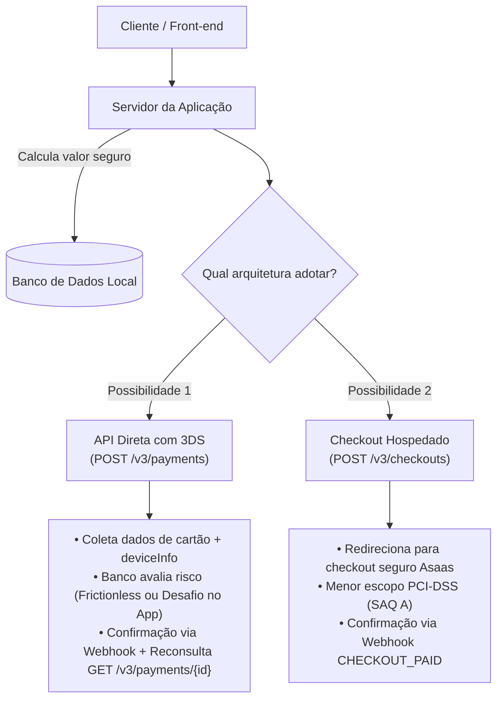
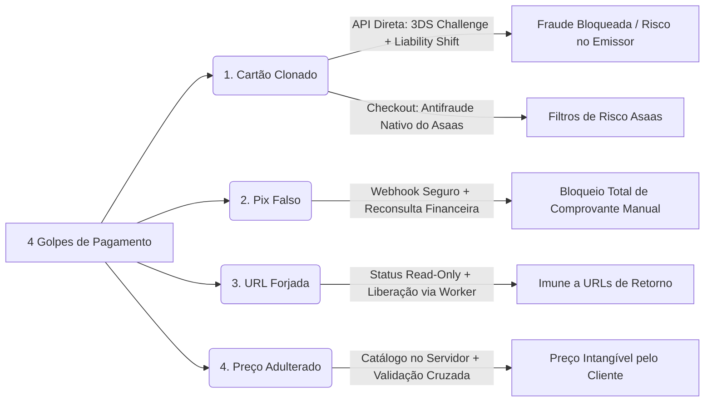
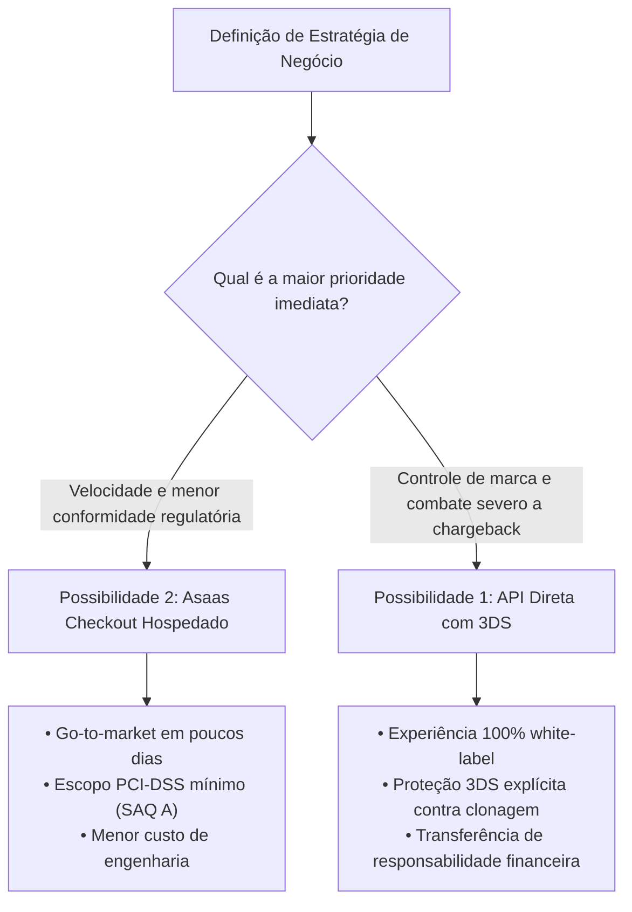
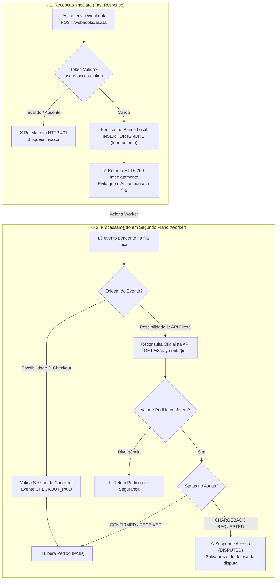

# Proposta de Arquitetura e Integração Antifraude Asaas

## Solução Técnica para Neutralização de Fraudes: API Direta com 3DS vs. Checkout Hospedado

---

## 1. Sumário Executivo

A empresa solicitou a integração com o gateway **Asaas** com o objetivo central de:

> _"Tornar o processo de pagamento seguro e confiável, reduzindo os riscos de fraude e garantindo que as informações de pagamento sejam verdadeiras."_

Foi repassada à equipe a recomendação de implementar o **"Sistema 3DS"**. A pesquisa minuciosa na documentação oficial do Asaas ([docs.asaas.com](https://docs.asaas.com/llms.txt)) revelou que:

1. **O 3DS não é um produto isolado:** Trata-se do protocolo _3-D Secure_ disponível especificamente na **API Direta de Cobrança** (`POST /v3/payments`), exigindo o envio dos objetos `threeDSecure` e `deviceInfo`.
2. **Existem Duas Vias de Arquitetura Oficiais:**
   - **Possibilidade 1: API Direta com Sistema 3DS:** Mantém o cliente no domínio da empresa (checkout transparente), autentica compras suspeitas de cartão no aplicativo do banco do portador e transfere a responsabilidade financeira por fraude de identidade (_Liability Shift_) para o banco emissor.
   - **Possibilidade 2: Asaas Checkout Hospedado (`POST /v3/checkouts`):** Redireciona o comprador para uma página segura hospedada pelo próprio Asaas, com suporte nativo a Pix e Cartão, reduzindo drasticamente a carga regulatória de conformidade com [PCI-DSS](https://docs.asaas.com/docs/pci-dss-1) para o nível mais simples (SAQ A).
3. **Imunidade aos demais 3 golpes em ambas as vias:** Seja qual for a escolha adotada pela diretoria, os golpes de **comprovante falso de Pix**, **confirmação forjada por URL de retorno** e **adulteração de preços no front-end** são **100% neutralizados** por princípios de design seguro de backend.

---

## 2. Diagnóstico: Anatomia dos 4 Golpes Atuais

A vulnerabilidade atual decorre de falhas estruturais de validação entre cliente e servidor:

| #     | Golpe                                    | Causa Raiz no Sistema Atual                              | Como o Fraudador Age                                                                      | Impacto Financeiro                                                                             |
| ----- | ---------------------------------------- | -------------------------------------------------------- | ----------------------------------------------------------------------------------------- | ---------------------------------------------------------------------------------------------- |
| **1** | **Cartão clonado / roubado**             | Ausência de validação do titular (_Cartão Não Presente_) | Usa credenciais vazadas na internet. A transação é aprovada porque a numeração é válida.  | O dono real contesta semanas depois (_chargeback_). O lojista perde a mercadoria e o dinheiro. |
| **2** | **Comprovante falso de Pix**             | Validação visual humana ou confiança em anexo de tela    | Adultera prints ou PDFs de comprovante bancário e envia ao atendimento ou sistema.        | Mercadoria ou serviço liberado sem crédito na conta bancária da empresa.                       |
| **3** | **Confirmação forjada (URL de retorno)** | Confiança cega no navegador (_Client-Side State_)        | Acessa diretamente a URL `/pedido/sucesso` ou manipula respostas de redirecionamento.     | O banco de dados local marca o pedido como "Pago" sem qualquer transação real.                 |
| **4** | **Adulteração de valores**               | Confiança no payload enviado pelo front-end              | Intercepta o request e altera o preço de `R$ 199,90` para `R$ 0,01`, ou altera o produto. | Venda concluída por valor irrisório.                                                           |

---

## 3. Visão Geral das Duas Possibilidades de Arquitetura



---

## 4. Comparativo Detalhado: API Direta (3DS) vs. Checkout Hospedado

| Critério                        | Possibilidade 1: API Direta com 3DS                                                                                                                              | Possibilidade 2: Asaas Checkout Hospedado                                                                   |
| ------------------------------- | ---------------------------------------------------------------------------------------------------------------------------------------------------------------- | ----------------------------------------------------------------------------------------------------------- |
| **Endpoint Principal**          | [`POST /v3/payments`](https://docs.asaas.com/reference/criar-cobranca-com-cartao-de-credito)                                                                     | [`POST /v3/checkouts`](https://docs.asaas.com/reference/criar-novo-checkout)                                |
| **Experiência do Usuário (UX)** | **Checkout transparente:** o usuário nunca sai do site da loja. Em caso de desafio 3DS, abre modal bancário seguro.                                              | **Página hospedada:** o cliente é redirecionado para `asaas.com/checkoutSession/show?id=...`.               |
| **Prevenção de Cartão Clonado** | **Máxima (3DS):** Exige validação no app do banco (_Push Notification_ / SMS) ou análise de telemetria do emissor.                                               | **Padrão:** O Asaas aplica seus filtros internos de risco, mas a documentação não referencia 3DS na sessão. |
| **Responsabilidade Financeira** | **Liability Shift:** Risco de chargeback por fraude de identidade (`ABSENT_CARD_FRAUD`) é transferido ao banco emissor.                                          | O estabelecimento assume a contestação de acordo com as regras contratuais padrão de adquirente.            |
| **Conformidade com PCI-DSS**    | **Exigente (SAQ A-EP ou SAQ D):** Como os números de cartão trafegam nos servidores da aplicação, exige rigorosa governança.                                     | **Mínimo (SAQ A):** Os dados de cartão nunca tocam na infraestrutura da empresa.                            |
| **Pix Integrado**               | Requer chamada específica a [`GET /v3/payments/{id}/pixQrCode`](https://docs.asaas.com/reference/obter-qr-code-para-pagamentos-via-pix) para renderizar na tela. | Nativo: a página de checkout já exibe Cartão e Pix dinâmico simultaneamente.                                |
| **Confirmação Financeira**      | Eventos `PAYMENT_CONFIRMED` / `PAYMENT_RECEIVED` + Reconsulta ativa com `GET /v3/payments/{id}`.                                                                 | Evento `CHECKOUT_PAID` com conferência de assinatura e dados da sessão (`status == "PAID"`).                |
| **Tempo de Implementação**      | **Médio a Alto:** Requer telemetria de dispositivo (`deviceInfo`), modal de desafio e homologação de 3DS no Asaas.                                               | **Rápido:** Poucas chamadas de API, página de checkout pronta e responsiva.                                 |

---

## 5. Como Cada Possibilidade Neutraliza os 4 Golpes



### Detalhamento das Proteções:

### 1. Cartão Clonado / Roubado

- **Na Possibilidade 1 (API Direta + 3DS):** Quando o sistema envia `threeDSecure` e `deviceInfo`, o banco do titular analisa a compra. Se houver suspeita, emite `ISSUER_CHALLENGE` e exige validação biométrica no celular do dono do cartão. O fraudador é barrado imediatamente. Caso passe silenciosamente (_Frictionless_), a responsabilidade pelo prejuízo é transferida ao banco (_Liability Shift_ para `ABSENT_CARD_FRAUD`).
- **Na Possibilidade 2 (Checkout Hospedado):** O Asaas processa a cobrança sob suas próprias camadas de análise de risco e filtros antifraude.

> [!NOTE] Limite Operacional do 3DS:
> O 3DS protege contra fraudes de identidade com cartão roubado/clonado (`ABSENT_CARD_FRAUD`). Ele **não isenta** a empresa de contestações por desacordo comercial (`COMMERCIAL_DISAGREEMENT`) ou não entrega de mercadorias. Por isso, a arquitetura implementada captura automaticamente a data limite de defesa (`deadlineToSendDisputeDocuments`) para permitir resposta formal via `POST /v3/chargebacks/{id}/dispute`.

### 2. Comprovante Falso de Pix

- **Ambas as soluções:** Nenhum ser humano e nenhuma rotina aceita comprovantes em anexo.
- O Pix é gerado de forma dinâmica e vinculado ao ID do pedido. A liberação de acesso ou produto ocorre **estritamente quando o Asaas notifica a liquidação bancária** via Webhook autenticado.

### 3. Confirmação Forjada (URL de Retorno)

- **Ambas as soluções:** URLs de sucesso (`/pedido/processando`) são páginas meramente informativas e **somente-leitura**. Elas apenas consultam o banco local via `GET /api/orders/{id}/status`.
- O status do pedido só muda para `PAID` dentro de transações de banco de dados no servidor, disparadas pela confirmação financeira do Asaas. Se um golpista digitar `/pedido/sucesso`, o sistema consultará o backend e mostrará "Pagamento Pendente".

### 4. Adulteração de Valores

- **Ambas as soluções:** O cliente envia apenas os identificadores dos produtos (`sku`) e quantidades.
- O valor unitário é recuperado exclusivamente de uma tabela/catálogo centralizado no backend. Na API Direta, o worker confere se `remote_payment.value == order.total`; no Checkout Hospedado, os itens e valores são fixados na criação da sessão. Se houver qualquer divergência de centavos, o pedido é imediatamente retido por segurança (_SecurityDivergence_).

---

## 6. Matriz de Decisão: Quando Escolher Cada Abordagem?



### Escolha a **Possibilidade 1 (API Direta com 3DS)** se:

1. O índice de perdas financeiras por cartões clonados for crítico e exigir autenticação formal no app bancário;
2. A identidade visual da marca exigir que o usuário permaneça 100% do tempo no domínio da empresa;
3. A equipe tiver capacidade para atender às normas de segurança da informação do padrão [PCI-DSS](https://docs.asaas.com/docs/pci-dss-1) (não armazenar CVV, criptografar dados de ponta a ponta);
4. Houver tempo para solicitar a ativação do 3DS junto à equipe de integrações do Asaas (`integracoes@asaas.com.br`).

### Escolha a **Possibilidade 2 (Checkout Hospedado)** se:

1. O objetivo for colocar a solução no ar com máxima rapidez;
2. A empresa desejar **eliminar o risco regulatório de manuseio de dados de cartão** (delegando 100% do formulário de cartão ao Asaas sob PCI SAQ A);
3. A experiência de redirecionamento para o checkout oficial do Asaas for bem aceita pelo modelo de negócio;
4. A prioridade imediata for neutralizar Pix falso, URL forjada e preço adulterado.

---

## 7. Arquitetura do Mecanismo de Webhook Blindado

O Webhook é o coração financeiro de ambas as integrações. Para garantir alta disponibilidade e evitar problemas documentados pelo Asaas:



### Por que essa divisão em duas fases é indispensável?

| Fase | O que faz | Por que é necessária? |
|---|---|---|
| **1. Recepção Síncrona** *(milissegundos)* | Valida o token e salva o evento no banco local com `INSERT OR IGNORE`, retornando `HTTP 200` imediatamente. | A documentação do Asaas alerta que **após 15 falhas consecutivas, a fila de webhooks da conta é pausada**. Não se deve processar regras de negócio pesadas dentro da resposta HTTP. |
| **2. Processamento Assíncrono** *(Worker)* | O worker lê a fila local, faz a reconsulta ativa na API e aplica as transições atômicas de status no pedido. | Isola a aplicação de instabilidades de rede, garante que nenhum pagamento seja aprovado por payload forjado e gerencia o ciclo de contestação de chargeback com tranquilidade. |

---

## 8. Roteiro Prático de Demonstração e Homologação

Para apresentar a solução em funcionamento aos avaliadores ou stakeholders:

### 1. Execução da Suíte de Testes Automatizada

No repositório, foi disponibilizada a pasta de código de referência `exemplo_integracao/`. Para executar todos os testes de segurança:

```bash
pytest exemplo_integracao/tests/test_security.py -v
```

**Cenários validados automaticamente pelos testes:**

- `test_ataque_1_webhook_sem_token_deve_retornar_401`: Garante que invasores não consigam forjar avisos de pagamento sem o segredo compartilhado.
- `test_ataque_2_tentativa_de_forjar_pagamento_pela_url_de_retorno`: Comprova que acessar rotas de retorno não altera o status do pedido.
- `test_ataque_3_adulteracao_de_preco_no_payload`: Comprova que tentativas de passar valor adulterado são ignoradas e o total é recalculado pelo backend.
- `test_validacao_luhn_cartao`: Valida a integridade matemática dos números de cartão antes do envio à adquirente.
- `test_chargeback_com_objeto_aninhado_suspende_pedido`: Simula o evento de contestação, confere o objeto aninhado `chargeback`, suspende o pedido (`DISPUTED`) e registra a data limite de defesa (`deadlineToSendDisputeDocuments`).
- `test_checkout_paid_valida_sessao_e_libera_pedido`: Demonstra a aprovação e liberação limpa de pedidos através da sessão de Checkout Hospedado.

---

### 2. Simulação no Sandbox Oficial do Asaas

Configurando as credenciais da conta de testes em `exemplo_integracao/.env`:

1. **Simulação de Recusa de Cartão (Sem persistência indevida):**
   - Enviar requisição de cartão utilizando os números oficiais de recusa do Asaas:
     - **Mastercard:** `5184019740373151`
     - **Visa:** `4916561358240741`
   - _Resultado demonstrado:_ A API do Asaas responde HTTP 400 (`invalid_creditCard`), nenhuma cobrança indevida é gravada e o pedido permanece protegido como pendente.
2. **Simulação de Aprovação Limpa:**
   - Enviar qualquer número gerado pelo algoritmo de Luhn com data futura e CVV `123`.
   - _Resultado demonstrado:_ Transação aprovada e transicionada para `PAID` somente após a chegada do Webhook oficial.
3. **Simulação de Pix Dinâmico:**
   - Gerar o QR Code via API e efetuar a simulação de liquidação no painel Sandbox do Asaas.
   - _Resultado demonstrado:_ O sistema ignora qualquer interação manual e libera o pedido no milissegundo em que o Webhook bancário é processado.

---

## 9. Índice de Documentação Oficial Consultada

Todas as definições desta proposta técnica foram diretamente fundamentadas nas especificações oficiais da plataforma Asaas:

- **Arquitetura & Boas Práticas:**
  - [Guia de Arquitetura de Integrações](https://docs.asaas.com/docs/guia-de-arquitetura-de-integra%C3%A7%C3%B5es)
  - [Integração não é apenas request/response](https://docs.asaas.com/docs/integra%C3%A7%C3%A3o-n%C3%A3o-%C3%A9-apenas-requestresponse)
  - [Retries e Idempotência](https://docs.asaas.com/docs/retries-e-idempot%C3%AAncia)
  - [Como implementar idempotência em Webhooks](https://docs.asaas.com/docs/como-implementar-idempotencia-em-webhooks)
  - [Fila de Webhooks pausada por 15 falhas](https://docs.asaas.com/docs/webhooks-queue-paused)
- **Possibilidade 1 (API Direta e 3DS):**
  - [Criar cobrança com 3DS](https://docs.asaas.com/docs/criar-cobran%C3%A7a-com-3ds)
  - [Cobranças via Cartão de Crédito](https://docs.asaas.com/docs/cobrancas-via-cartao-de-credito)
  - [`POST /v3/payments` (Referência OpenAPI)](https://docs.asaas.com/reference/criar-cobranca-com-cartao-de-credito)
  - [Chargeback e Contestação](https://docs.asaas.com/docs/chargeback)
  - [`POST /v3/chargebacks/{id}/dispute` (Envio de Documentos de Defesa)](https://docs.asaas.com/reference/criar-disputa-de-chargeback)
  - [Testando pagamento com cartão de crédito (Cartões de Erro)](https://docs.asaas.com/docs/testando-pagamento-com-cart%C3%A3o-de-cr%C3%A9dito)
- **Possibilidade 2 (Checkout Hospedado):**
  - [Visão Geral do Asaas Checkout](https://docs.asaas.com/docs/checkout-asaas)
  - [`POST /v3/checkouts` (Criar novo checkout)](https://docs.asaas.com/reference/criar-novo-checkout)
  - [Link do checkout e redirecionamento do cliente](https://docs.asaas.com/docs/link-do-checkout-e-redirecionamento-do-cliente)
  - [Eventos para Checkout](https://docs.asaas.com/docs/eventos-para-checkout)
  - [FAQ do Asaas Checkout](https://docs.asaas.com/docs/faq-do-asaas-checkout)
- **Segurança & Conformidade:**
  - [Normas de Segurança PCI-DSS no Asaas](https://docs.asaas.com/docs/pci-dss-1)
  - [Ambiente de Testes (Sandbox)](https://docs.asaas.com/docs/sandbox)
